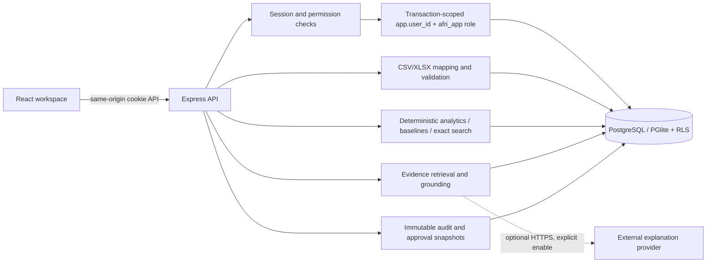
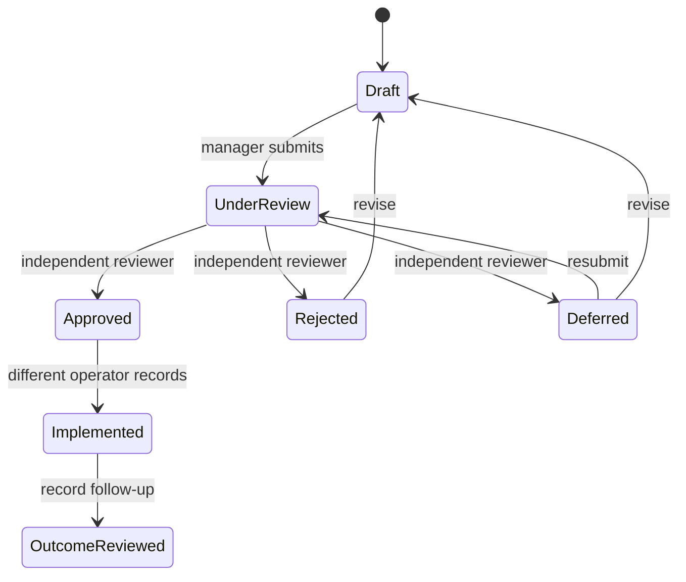

# Architecture

## Runtime

A modular monolith: React 19 + TypeScript + Vite + Tailwind CSS + Recharts on the client; Express 5 + Zod on the server; PostgreSQL through `pg`, or persistent embedded PostgreSQL through PGlite locally. One origin serves the API and browser assets, avoiding browser-facing localhost URLs and cross-origin credential sharing.

## Request and tenant boundary

1. Unsafe API requests require `X-AfriScope-Request: 1`; a supplied Origin must match the configured origin or request host.
2. Sign-in accepts a username or email; a hashed opaque session token resolves the user through the administrative connection.
3. Each scoped transaction sets `app.user_id` and `SET LOCAL ROLE afri_app`.
4. RLS policies use membership helper functions; API permission checks provide clear errors and defence in depth.
5. Tenant and cross-project reference triggers protect relational links. Evidence, versions, runs, approvals, and audit records have no application-role update policy.
6. Administrative operations are narrow server functions (authentication, invitations, membership changes, guarded demo reset), not arbitrary SQL endpoints.

## Data flow

Upload → bounded parsing → preview job → explicit column mapping → server validation → accepted immutable version + retained rejections → quality report → recalculation → analytical run + evidence → recommendation → approval snapshot → implementation/outcome notes. Saved reports embed the evidence snapshot available when generated.

## Important modules

- `shared/domain.ts`: roles, permissions, transitions, display helpers.
- `shared/analytics.ts`: pure inventory, forecast, finance, allocation functions.
- `server/schema.mjs`: relational metadata used by migration generation and allowlisted CRUD.
- `server/validation.ts`: import schemas, business-key checks, reference/unit/currency checks, quality reporting.
- `server/services.ts`: source selection, analysis persistence, alerts, scenarios, reports.
- `server/assistant.ts`: project-scoped retrieval, local templates, optional external explanation, grounding checks.
- `src/lib/store.tsx`: workspace/project state and effective-role UI gating.
- `src/features/*`: connected product modules.

## Scale and deployment choices

PGlite serialises complete transactions on one embedded connection and suits a single-instance demo. A process lock prevents a second server/CLI process from opening the same database directory; use the running server API for demo reset, or stop the server before CLI maintenance. PostgreSQL mode uses a small pool and the same migrations/RLS. External PostgreSQL was not available in the build environment, so that adapter is implemented but not integration-tested against a server. No microservices, queue, or distributed cache are required for this MVP. Synchronous analysis is bounded by the current fixture size; larger imports need background jobs and pagination.
